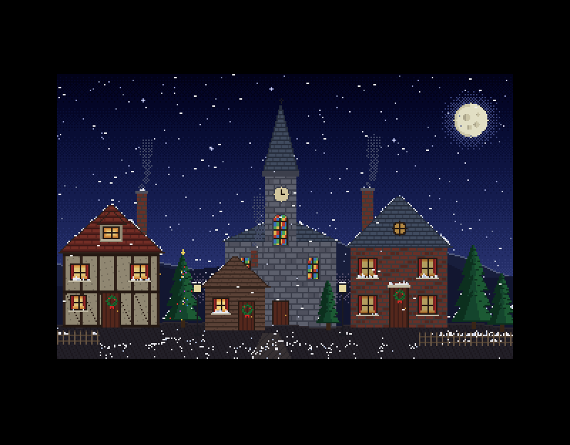
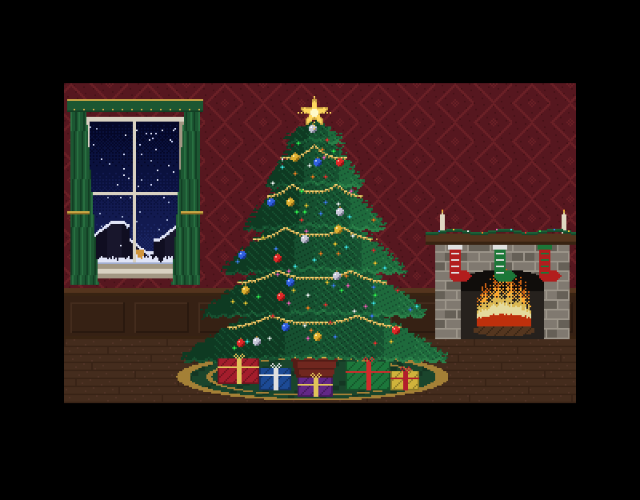
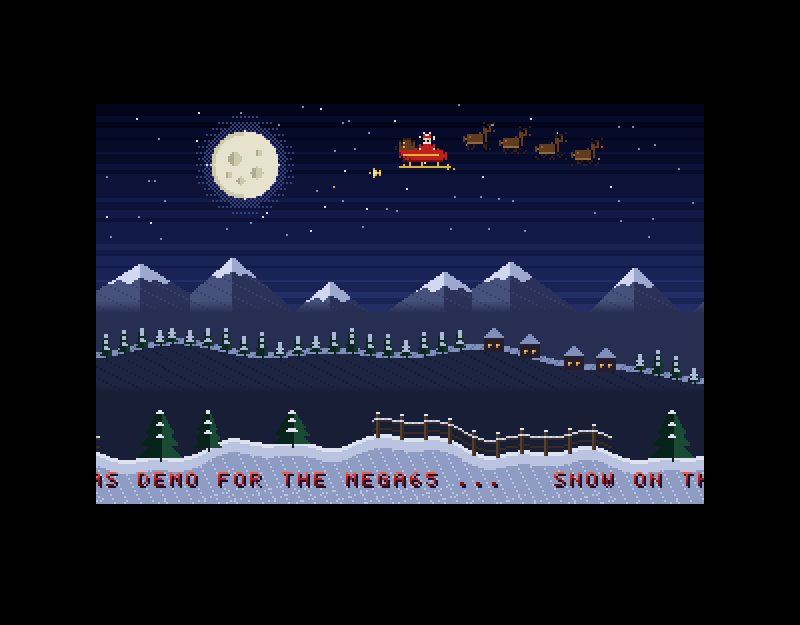
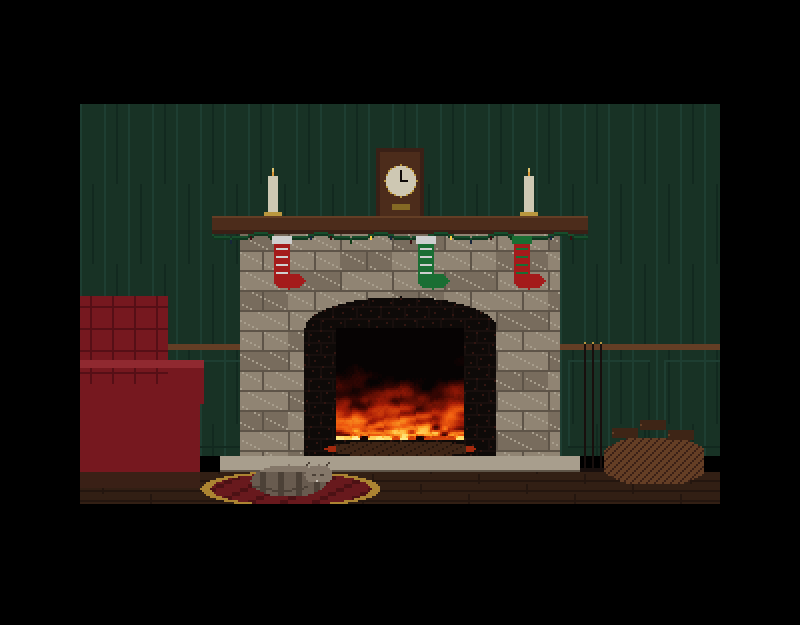
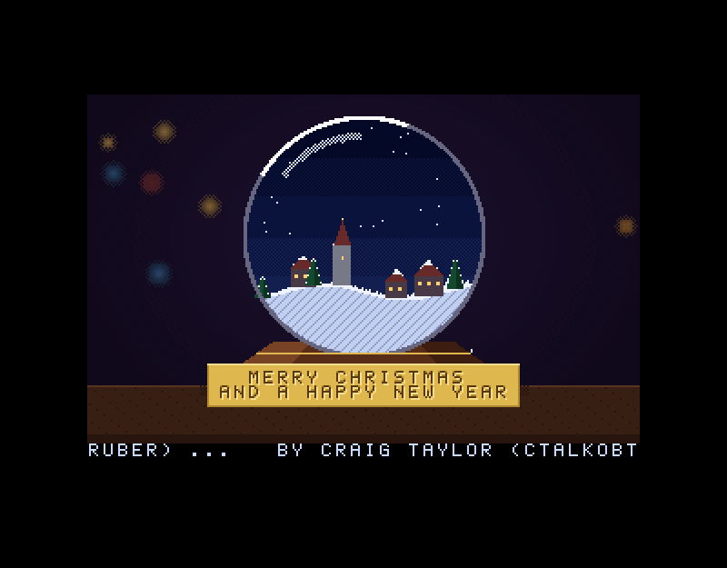

# Midwinter

A Christmas demo for the MEGA65, written in C with the
[M65Compiler](https://github.com/CTalkobt/M65Compiler) tool suite (cc45,
ln45, pack45, tune45, disk45). There are six scenes, each loaded from disk
as it begins, and each with a carol on the SID chips. It ends with a snow
globe whose plaque carries your own greeting, so the disk doubles as a
Christmas card.

## The scenes

| | Scene | Carol |
|---|---|---|
| 1 | **The village.** Snow falls in three layers in front of and behind the houses, and settles on the roofs, sills and ground in front of them. | *God Rest Ye Merry, Gentlemen* |
| 2 | **The tree.** The tree's lights come on group by group. Snow falls past the window and drifts on its sill. | *O Tannenbaum* |
| 3 | **The sleigh ride.** Three parallax bands. The sleigh and reindeer turn to silhouettes as they cross the moon, with a greetings scroller below. | *Ding Dong Merrily on High* (arr. Charles Wood) |
| 4 | **The snowflakes.** A Koch snowflake grows over an icy plasma that moves only by palette, while large crystals drift and turn in front. | *Shchedryk* (Mykola Leontovych), the tune of *Carol of the Bells* |
| 5 | **The fireside.** A fire simulation in the hearth. The room's light flickers with it and the garland twinkles. | *Once in Royal David's City* (Henry Gauntlett, arr. A. H. Mann) |
| 6 | **The snow globe.** Every so often (or on SPACE) the globe is shaken: the snow is thrown up, swirls, bounces off the glass and settles again. The plaque shows the greeting, and the credits scroll below. | *Silent Night* (Franz Xaver Gruber) |








The carols are all in the public domain. The melodies and harmonies were
transcribed from the LilyPond scores in their Wikipedia articles
(`tools/lily.py` reads them) and arranged for the SIDs in
`tools/gen_music.py`.

## Watching

Copy `xmas.d81` to the SD card, mount it and `RUN "XMAS"`. In xemu:
`xemu-xmega65 -8 xmas.d81 -autoload`.

| Key | Action |
|---|---|
| N | the next scene |
| SPACE | the village: start it again (fresh snow). The snow globe: shake it |

The scenes play in turn for about five minutes, then start again.

## Your own greeting

```
make card LINE1="TO THE SMITHS" LINE2="LOVE FROM JO & SAM"
```

This writes a `GREETING` file to `build/xmas.d81` (up to 20 characters a
line: letters, digits, space and `. , ! ? ' - : & * ( ) @`). Without the
file, the plaque reads MERRY CHRISTMAS / AND A HAPPY NEW YEAR.

## Building

You need the [M65Compiler](https://github.com/CTalkobt/M65Compiler) tree
built next to this one (or set `M65=`), Python 3 with Pillow, and xemu to run
it.

| Target | |
|---|---|
| `make` | build `build/xmas.d81` |
| `make run` | boot it in xemu (`SCENE=n` to start at scene n) |
| `make hw` | send it to a MEGA65 and mount it (deploy45) |
| `make shot` | a headless screenshot, `build/shot.png` (`SHOT_DELAY` seconds in) |
| `make play` | play the music on this computer |
| `make budget` | the RRB budget test |

The Makefile's header describes how the disk is laid out, and each source
file starts with a description of how it works.

## Status

Version 0.9 has only been tested in xemu, not yet on MEGA65 hardware.
Still to check on hardware:

- the RRB budget: the widest rows have 89 cells
- the sprites' x offset
- the timing of the snow and fire updates
- the load times between scenes

## Credits

By Craig Taylor (ctalkobt@ctalkobt.net) and Claude AI.
